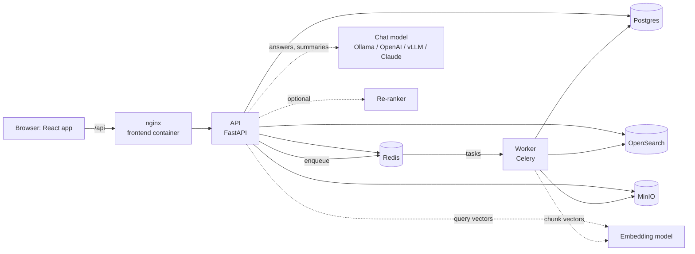

# Architecture

How RagNex is put together: the services, what happens when a document is uploaded or a
question is asked, how workspaces are kept apart, and where things live in the code. For
setting up a development environment, see [development.md](development.md); for adding
providers, parsers or templates, [extending.md](extending.md).

## Services



| Service | Does | Code |
|---|---|---|
| Web app | React single-page app; talks only to `/api` | `frontend/` |
| nginx | Serves the web app, forwards `/api` to the API, sets the client IP | `docker/nginx.conf.template` |
| API | HTTP API: accounts, workspaces, knowledge bases, uploads, search, chat | `backend/app/` (`main.py`, `api/v1/`) |
| Worker | Background work: parsing, embedding and indexing documents; purging deleted ones | `backend/app/tasks/` |
| Postgres | Users, workspaces, knowledge bases, documents and their chunks, chats, settings | `backend/app/models/`, `backend/alembic/` |
| Redis | Celery task queue and results, embedding cache, rate-limit counts | |
| OpenSearch | Search index: chunk text (keyword search) and vectors (similarity search) | `services/opensearch.py`, `services/search.py` |
| MinIO | Uploaded files, as uploaded | `services/storage.py` |
| Models | Chat model, embedding model, optional re-ranker: external services RagNex calls over HTTP | `services/llm*.py`, `embeddings.py`, `rerank.py` |

The API and the worker are the same image (`docker/backend.Dockerfile`) started with a
different command, and read the same settings ([configuration.md](configuration.md)).

## A document's journey

```mermaid
sequenceDiagram
    participant U as User
    participant A as API
    participant M as MinIO
    participant Q as Redis queue
    participant W as Worker
    participant P as Postgres
    participant O as OpenSearch
    U->>A: POST /knowledgebases/{id}/documents
    A->>M: store the file (workspace bucket)
    A->>P: Document row, status pending
    A->>Q: parse_document
    A-->>U: 200 (id, status pending)
    Q->>W: parse_document
    W->>M: read the file
    W->>W: DeepDoc parser, then the knowledge base's chunking template
    W->>P: Chunk rows; status done
    W->>Q: index_document
    Q->>W: index_document
    W->>W: embed each chunk (embedding model, cached in Redis)
    W->>O: bulk-index text + vectors
    W->>P: status indexed
```

1. **Upload** (`api/v1/documents.py`): the type and size are checked, the file goes to the
   workspace's MinIO bucket (`tenant-<id>`), a `Document` row is created with status
   `pending`, and `parse_document` is queued.
2. **Parsing** (`tasks/parsing.py`, queue `parsing`): `services/parsing.py` picks the DeepDoc
   parser for the extension (`deepdoc/parser/`) and turns the file into text sections. The
   knowledge base's template (`services/chunking/general.py`, `laws.py`, `paper.py`) cuts
   them into chunks, saved as `Chunk` rows. Status `parsing`, then `done`, then
   `index_document` is queued.
3. **Indexing** (`tasks/indexing.py`, queue `indexing`): each chunk is embedded
   (`services/embeddings.py`, vectors cached in Redis) and written to the workspace's
   OpenSearch index with its text. Status `indexing`, then `indexed`.
4. **Failures** at any step set status `failed` with the error in `error_message`.
   Indexing retries up to three times first (the embedding model may be briefly
   unavailable); parsing fails at once, since a file that can't be parsed won't parse on a
   retry. **Reprocess** (`POST /documents/{id}/reprocess`) runs the stored file through
   both steps again.
5. **Deletion** is two-phase: the API marks the document deleted, which hides it from
   search and the API at once, then queues `purge_document` (`tasks/purge.py`), which
   removes its index entries, chunk rows and file, and can safely run more than once.
   Deleting a knowledge base does the same for each of its documents. Deleting a
   **workspace** deletes its database rows at once (they cascade), then queues
   `purge_workspace`, which deletes its search indexes and file bucket
   (`services/workspace_purge.py`).

## A question's journey

1. **Search** (`services/search.py`): the question is embedded, then two OpenSearch
   queries run over the chat's knowledge bases: keyword (BM25) and vector similarity
   (k-NN). Their rankings are merged with reciprocal rank fusion, and hits from documents
   deleted meanwhile are dropped. If a re-ranker is configured (`services/rerank.py`), the
   best candidates are re-scored by it; if it fails, the fused order is used.
2. **Prompt** (`services/prompt_budget.py`): system prompt, retrieved passages, the chat's
   summary and recent messages are fitted into the model's context window, in that order
   of priority, leaving room for the answer.
3. **Answer** (`api/v1/chat.py`): the workspace's chat model (`services/llm.py`,
   `llm_anthropic.py`) writes the answer, streamed to the browser as server-sent events.
   Generation runs as its own task, so a disconnect doesn't lose the answer. The answer is
   saved with citations to the passages it was given.
4. **Summary** (`services/conversation_summary.py`): after saving, if the chat has
   outgrown its share of the prompt, its oldest exchanges are folded into a running summary
   in the background.

## Workspaces and isolation

Everything a user creates belongs to a workspace (a `Tenant` in the code). Each request
names its workspace in the `X-Tenant-ID` header, and `core/deps.py` checks membership
before any handler runs:

| Store | How workspaces are kept apart |
|---|---|
| Postgres | Every workspace-owned row has `tenant_id`; queries filter on it |
| OpenSearch | One index (alias `chunks_<tenant id>`) per workspace, plus a `tenant_id` filter on every query |
| MinIO | One bucket per workspace (`tenant-<tenant id>`) |
| Redis | Shared; holds no workspace data beyond cached embedding vectors, keyed by provider, model and a hash of the text |

Other workspaces' documents and knowledge bases answer 404 rather than 403, so their
existence isn't revealed.

## Authentication

- **Login tokens** (`core/security.py`): short-lived access tokens and longer refresh
  tokens, HS256-signed with `JWT_SECRET`. Passwords are argon2 hashes.
- **API keys** (`core/api_keys.py`, `api/v1/api_keys.py`): belong to one workspace and
  carry `read` or `write` access; stored as SHA-256 hashes. They can't manage accounts:
  `require_session_user` endpoints refuse them.
- **Rate limits** (`core/rate_limit.py`): per client address on login and sign-up,
  counted in Redis.
- **Secrets at rest** (`core/encryption.py`): workspaces' model API keys are encrypted
  with `RAGNEX_ENCRYPTION_KEY`.

## Code map

```
backend/app/
  main.py              app factory: routers, middleware, error handlers
  api/v1/              HTTP endpoints, one module per area
  core/                settings, database, auth dependencies, security, encryption
  models/              SQLAlchemy models
  services/            the work itself: parsing, chunking, search, LLMs, storage, ...
  tasks/               Celery tasks (thin: they call services)
backend/alembic/       database migrations (0001, 0002, ... in order)
backend/tests/         pytest suite; most tests run against the real data stores
deepdoc/               document parsers, derived from RAGFlow's DeepDoc (Apache-2.0)
frontend/src/
  pages/               one component per route
  components/          UI pieces, grouped by area
  services/            API calls (apiClient.ts adds auth and workspace headers,
                       refreshes tokens); sse.ts parses streamed answers
  store/auth.tsx       sign-in state and the current workspace
docker/                Dockerfiles, nginx config, container entrypoint
docs/                  this documentation
```

## Design notes

Choices that aren't obvious from the code alone:

- **Pages read column by column** only when the stored text mixes two columns; otherwise
  pypdf's text is kept, because it handles inline math better
  (`deepdoc/parser/pdf_parser.py`).
- **Re-ranking and summaries degrade, they don't fail**: a failing re-ranker falls back to
  the search order, a failing summary keeps the old one; answering continues either way.
- **The embedding model is locked** once a workspace has indexed documents: vectors from
  different models can't be compared.
- **Workspace model endpoints are allowlisted** (`TENANT_MODEL_BASE_URLS`): letting
  workspace owners choose any URL would let them make the server call internal addresses.
- **Uploaded files are only ever downloaded**, never shown in the browser: an HTML file
  opened in RagNex's origin would run with the viewer's session.
- **Unused code**: the `embed_texts` Celery task (`tasks/embedding.py`) is registered but
  nothing queues it; indexing embeds chunks itself.
